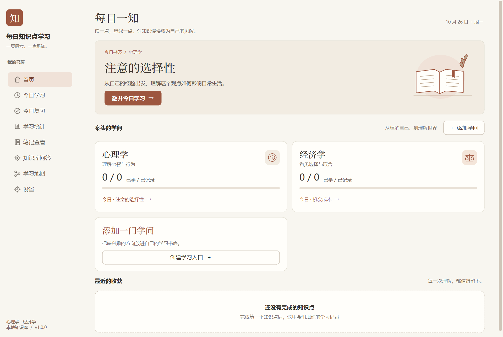

<p align="center"></p>

# 每日知识点学习

**从今日的一页学习单，到属于自己的知识地图。**

一款连接 AI 与 Obsidian 的 Windows 桌面学习助手。选择一门学问，从学习地图中选出下一主题，让 AI 生成材料；阅读、补充自己的理解，再交流、保存和归档。学习内容以 Markdown 留在本地，方便继续编辑、回看与复习。

[下载 Windows 成品](https://github.com/Uyuh99/daily-knowledge-learning/releases/latest) · [首次使用](#首次使用) · [AI 接口配置](#ai-接口配置) · [开发与构建](#开发与构建)



> 截图由当前应用使用示例学习地图渲染，不包含个人笔记或密钥。

## 下载与运行

**Windows 10/11 64 位，无需安装 Python、Obsidian 或开发工具即可启动。** Obsidian 可用于查看和管理同一份 Markdown 笔记。

| 下载 | 使用方式 |
| --- | --- |
| [安装程序（推荐）](https://github.com/Uyuh99/daily-knowledge-learning/releases/download/v1.0.0/daily-knowledge-learning-setup-v1.0.0.exe) | 双击安装，通过开始菜单或桌面快捷方式启动 |
| [便携版 ZIP](https://github.com/Uyuh99/daily-knowledge-learning/releases/download/v1.0.0/daily-knowledge-learning-portable-v1.0.0.zip) | 解压全部文件，运行 `daily-knowledge-learning.exe`；保留旁边的 `_internal` 目录 |
| [入门学习地图](https://github.com/Uyuh99/daily-knowledge-learning/releases/download/v1.0.0/daily-knowledge-learning-starter-vault.zip) | 没有现成 Vault 时可解压使用，内含心理学、经济学起步主题 |

请下载 Release 中的安装程序或便携版，GitHub 自动生成的 **Source code** 压缩包是开发源码。

## 可以做什么

| 功能 | 用途 |
| --- | --- |
| 今日学习 | 根据地图和已学记录选题，生成包含概念、机制、例子、边界、误区与自测的学习单 |
| 三版本笔记 | 分开保存学习前版、交流后版和 AI 参考版，保留自己的理解与 AI 内容的区别 |
| 学习地图 | 查看主题和进度，归档完成后记录学习状态，为后续选题提供依据 |
| 添加学问 | 自定义学科名称与起步主题，生成对应目录和学习路线 |
| 间隔复习 | 查看到期复习任务，记录复习完成情况 |
| 学习统计 | 查看完成率、连续学习天数、近 7 天活动及各学问进度 |
| 知识库问答 | 检索本地 Markdown 后请 AI 结合相关摘录回答，并显示来源 |
| 多供应商与网关 | 配置 DeepSeek、OpenAI、Claude 等服务，或填写兼容中转站地址 |

## 首次使用

1. 安装或解压后启动软件，进入 **设置**。
2. 选择 Vault（笔记库）目录。第一次使用可先解压入门学习地图，选择包含 `心理学` 和 `经济学` 文件夹的目录。
3. 选择 AI 供应商，填写该供应商支持的模型名、API 地址和自己的 API 密钥，测试连接并保存。
4. 进入 **今日学习**，选择学问，点击开始按钮，等待学习单生成。
5. 阅读材料，在笔记中补充自己的理解并保存；随后进行 AI 交流、查看参考版，再确认归档。
6. 在 **学习地图** 回看进度，在 **今日复习** 与 **学习统计** 继续跟踪。

也可以在首页点击 **添加学问** 创建自己的路线。已有 Vault 的内置心理学、经济学地图格式可参考 [入门地图](examples/starter-vault)。

> [!NOTE]
> 软件本身不附带 API 密钥。AI 生成和问答需要网络、有效密钥及供应商可用额度；费用由所选供应商收取。离线模式可以浏览、编辑和保存笔记，模拟服务仅用于开发测试。

## AI 接口配置

| 选项 | 协议与配置 |
| --- | --- |
| DeepSeek | OpenAI 兼容接口；默认地址 `https://api.deepseek.com` |
| OpenAI | Chat Completions；默认地址 `https://api.openai.com/v1` |
| Claude / Anthropic | Messages API；默认地址 `https://api.anthropic.com` |
| 硅基流动、OpenRouter | 内置对应服务的默认地址，模型需填写该服务实际支持的名称 |
| 自定义中转网关 | 选择 OpenAI 或 Anthropic 兼容协议，填写网关地址、模型和该网关的密钥 |

模型名称和访问权限取决于供应商或中转站。完整学习单可能比连接测试耗时更长，学习生成请求的等待上限为 90 秒。

## 数据与隐私

- 笔记保存在你选择的本地 Vault 中，普通 Markdown 可由 Obsidian 或其他编辑器打开。
- API 密钥通过 `keyring` 保存在系统凭据库中，普通配置 JSON 不保存密钥。
- 使用在线 AI 时，会向所选服务发送对应提示词和学习内容；知识库问答会发送问题及检索命中的笔记摘录。
- 发布包不包含作者的 API 密钥、个人 Vault 或个人配置。便携版也会使用本机的用户配置与系统凭据库。

详见 [安全与数据说明](docs/security.md)。当前安装包尚未配置代码签名和自动更新。

## 开发与构建

以下内容供开发者使用，普通用户直接下载成品即可。

技术栈：Python 3.13+ · PySide6 · Markdown · keyring · PyInstaller · Inno Setup。

```powershell
git clone https://github.com/Uyuh99/daily-knowledge-learning.git
cd daily-knowledge-learning
uv sync
uv run pytest
uv run python -m daily_knowledge_learning.ui
```

在 Windows 安装 Inno Setup 6 后构建：

```powershell
powershell -ExecutionPolicy Bypass -File tools/build_windows.ps1
```

脚本清理本仓库的 `build/`、`dist/`，构建应用并检查主窗口启动，随后生成安装程序和便携 ZIP。构建产物不提交到源码仓库，分发文件放在 GitHub Releases。

## 项目文档

- [架构和数据流](docs/architecture.md)
- [核心模块](docs/core-modules.md)
- [界面设计规范](docs/ui-design-system.md)
- [版本说明](docs/releases/1.0.0.md)
- [更新记录](CHANGELOG.md)
